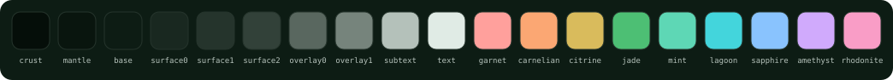
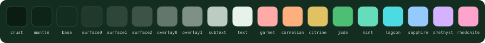
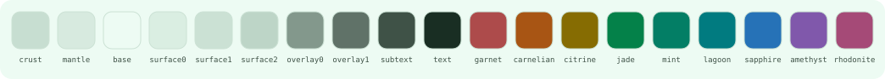

<div align="center">


# Nephrite para Thunderbird

[English](README.md) · **Español**

Un tema sereno, inspirado en el jade, para [Thunderbird](https://www.thunderbird.net), en tres sabores.

[](LICENSE.es.md)
[](https://github.com/Nephrite-theme/palette)

</div>

## Sabores

| Sabor | Colores usados | Para |
| --- | --- | --- |
| **Forest** |  | Oscuro y profundo, para la noche |
| **Jade** |  | Oscuro con más verde, para jornadas largas |
| **Mint** |  | Claro y ligero, para el día |

## Instalación

Necesita Thunderbird 128 o superior.

### Desde un archivo

1. Descarga este repositorio (**Code > Download ZIP**) y descomprímelo. Cada sabor está en su propia carpeta dentro de `themes/`, por ejemplo `themes/Nephrite Forest`.
2. Comprime el **contenido** de la carpeta del sabor, para que `manifest.json` quede en la raíz del ZIP. En PowerShell:

   ```powershell
   Compress-Archive -Path "themes/Nephrite Forest/*" -DestinationPath nephrite-forest.zip
   ```

3. En Thunderbird, abre **Complementos y temas**, haz clic en el engranaje, elige **Instalar complemento desde archivo** y selecciona el ZIP.

Para volver al aspecto original, abre **Complementos y temas** > **Temas** y activa **Tema del sistema**.

## Colores

Todos los colores vienen de la [paleta Nephrite](https://github.com/Nephrite-theme/palette), asignados a Thunderbird por rol:

| Superficie de Thunderbird | Color de la paleta |
| --- | --- |
| Marco de la ventana y barra de pestañas | `mantle`, `crust` cuando la ventana está inactiva |
| Pestaña activa, barras de herramientas, panel de carpetas, lista de mensajes | `base` |
| Búsqueda y otros campos | `surface0`, con borde `jade` al enfocar |
| Menús y listas desplegables | `mantle`, `surface1` para la fila resaltada |
| Carpeta o mensaje seleccionado | `surface1`, con borde `jade` |
| Texto principal | `text` |
| Pestañas inactivas e íconos | `subtext` |
| Línea de la pestaña activa, carga, íconos de aviso | `jade` |

Los menús y el contenido de los mensajes también siguen el modo claro u oscuro del sabor.

## Desarrollo

Los manifiestos de `themes/` se generan, así que no los edites a mano. Para aplicar cambios de la paleta:

```sh
node scripts/sync-palette.mjs   # descarga el palette.json más reciente
node scripts/build.mjs          # regenera los tres manifiestos
```

Para publicar, sube `VERSION` en `scripts/build.mjs`, vuelve a generar, comprime cada sabor como se explica arriba y súbelo en [addons.thunderbird.net/developers](https://addons.thunderbird.net/developers/). Cada sabor tiene un ID fijo (`nephrite-<sabor>-thunderbird@getnephrite.dev`), así que las actualizaciones quedan en la misma ficha. Node 18 o superior, sin dependencias.

## Contribuir

¿Encontraste un color que choca, o una parte de Thunderbird que el tema no cubre? [Abre un issue](https://github.com/Nephrite-theme/thunderbird/issues/new/choose) con una captura. Para saber cómo se construyen y revisan los ports de Nephrite, lee la [guía de contribución](https://github.com/Nephrite-theme/.github/blob/main/CONTRIBUTING.es.md).

## Agradecimientos

Creado y mantenido por [@ingfranciscastillo](https://github.com/ingfranciscastillo). Los colaboradores aparecerán aquí a medida que crezca la comunidad.

## Más Nephrite

Nephrite también está disponible para Chrome, Firefox, VS Code, Spotify y siete terminales. Mira todas las apps en [getnephrite.dev/es/ports](https://getnephrite.dev/es/ports).
