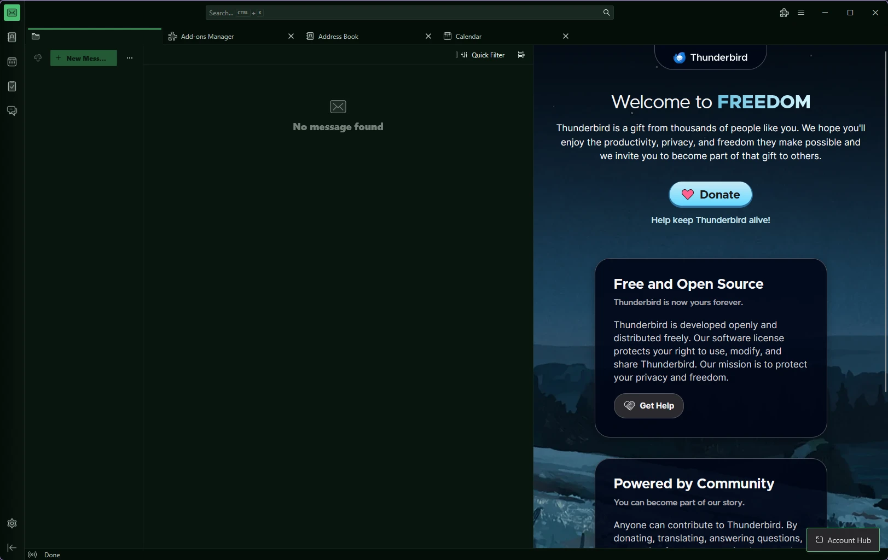
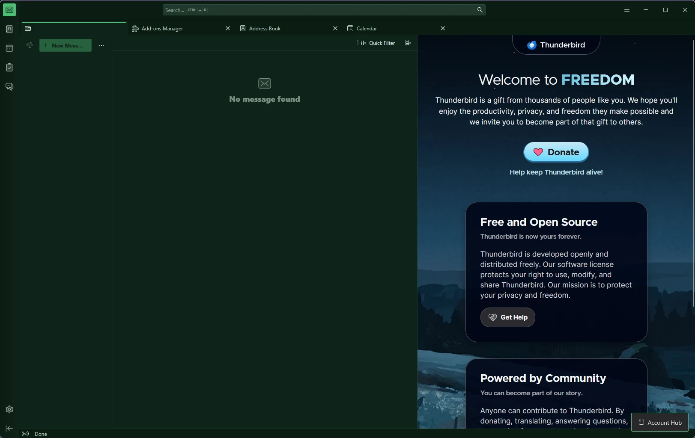
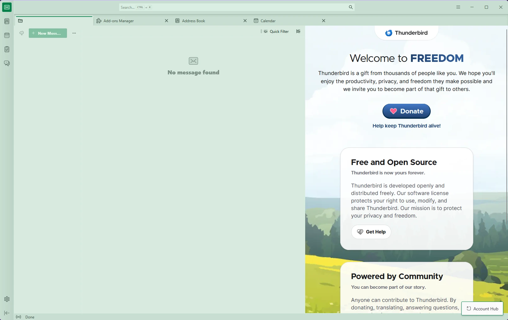

<div align="center">


# Nephrite for Thunderbird

**English** · [Español](README.es.md)

A calm, jade-inspired theme for [Thunderbird](https://www.thunderbird.net), in three flavors.

[](LICENSE)
[](https://github.com/Nephrite-theme/palette)

</div>

## Flavors

| Flavor | Colors used | For |
| --- | --- | --- |
| **Forest** |  | Deep and dark, for late nights |
| **Jade** |  | Dark with more green, for long days |
| **Mint** |  | Light and airy, for daylight |

## Previews







## Install

Requires Thunderbird 128 or newer.

### From a file

1. Download this repository (**Code > Download ZIP**) and unzip it. Each flavor lives in its own folder under `themes/`, for example `themes/Nephrite Forest`.
2. Zip the **contents** of the flavor's folder, so `manifest.json` sits at the root of the ZIP. From the repository folder, in a terminal on Windows, macOS or Linux:

   ```sh
   tar -a -cf nephrite-forest.zip -C "themes/Nephrite Forest" manifest.json nephrite.css icons
   ```

   On Windows, use `tar` rather than PowerShell's `Compress-Archive`, which can store paths with backslashes that add-on validators reject. On macOS or Linux without `-a` support, `cd` into the folder and run `zip -r ../../nephrite-forest.zip .`

3. In Thunderbird, open **Add-ons and Themes**, click the gear icon, choose **Install Add-on From File** and pick the ZIP.

To go back to the default look, open **Add-ons and Themes** > **Themes** and enable **System theme**.

## Colors

Every color comes from the [Nephrite palette](https://github.com/Nephrite-theme/palette), mapped to Thunderbird by role:

| Thunderbird surface | Palette color |
| --- | --- |
| Window frame, tab strip and spaces bar | `crust` |
| Selected tab, toolbars, message header, folder pane, message list | `mantle` |
| Message cards and main content | `base`, with a `surface0` border |
| Search and other fields | `surface0`, with a `jade` border on focus |
| Menus and dropdowns | `mantle`, `surface1` for the highlighted row |
| Accent: selected folder, selected space, primary buttons, toggles, focus rings, links, new messages | `jade` |
| Main text | `text` |
| Inactive tabs, toolbar icons, secondary text | `subtext` |
| Folder icons | `jade` inbox, `amethyst` drafts, `mint` sent, `carnelian` archive, `garnet` spam, `lagoon` outbox, `citrine` folders |

Thunderbird's documented theme keys only reach the frame, toolbars and trees. Everything else (the spaces bar, message cards, folder icons, counters and the blue accent) comes from Thunderbird's own CSS variables, which the themes set through a [theme experiment](https://webextension-api.thunderbird.net/en/mv3/theme.html#theme-experiment). Menus and message content also follow the flavor's light or dark scheme.

## Development

The manifests in `themes/` are generated, so don't edit them by hand. The few widgets that the manifest can't reach, like the mini calendar, are styled in `theme/nephrite.css`, which the build copies into each flavor. To pick up palette changes:

```sh
node scripts/sync-palette.mjs   # download the latest palette.json
node scripts/build.mjs          # regenerate the three manifests
```

To publish, bump `VERSION` in `scripts/build.mjs` (and `MAX_VERSION` when a new Thunderbird release is out, since ATN requires a maximum for theme experiments), rebuild, zip each flavor as shown above and upload it at [addons.thunderbird.net/developers](https://addons.thunderbird.net/developers/). Each flavor has a fixed add-on ID (`nephrite-<flavor>-thunderbird@getnephrite.dev`), so updates stay on the same listing. Node 18 or newer, no dependencies.

## Contributing

Found a color that clashes, or a part of Thunderbird the theme misses? [Open an issue](https://github.com/Nephrite-theme/thunderbird/issues/new/choose) with a screenshot. For how Nephrite ports are built and reviewed, see the [contributing guide](https://github.com/Nephrite-theme/.github/blob/main/CONTRIBUTING.md).

## Thanks

Created and maintained by [@ingfranciscastillo](https://github.com/ingfranciscastillo). Contributors will be listed here as the community grows.

## More Nephrite

Nephrite is also available for Chrome, Firefox, VS Code, Spotify and seven terminals. See every app at [getnephrite.dev/ports](https://getnephrite.dev/ports).
